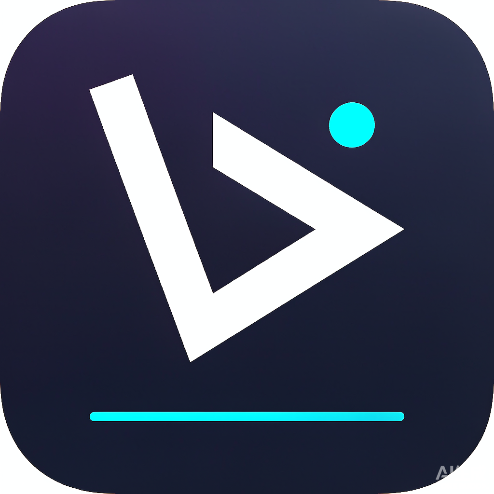

<p align="center">
  
</p>

<h1 align="center">VBob</h1>

<p align="center">
  本地优先的视频库管理器：扫描、刮削、整理、播放，一个页面搞定。
</p>

<p align="center">
  
  
  
  
</p>

## 简介

VBob 是一个**完全本地运行**的视频库管理工具。它扫描你指定的目录，从文件名中提取番号、标题、年份和集数，通过可配置的刮削源补全元数据，最后以海报墙的形式浏览、筛选和播放。

- **本地优先**：数据库、封面、日志都保存在本机 `data/`，不需要账号或云服务；
- **开箱即用**：Windows 用户下载解压后双击 `VBob.exe` 即可，无需安装 Python 或 Node.js；
- **可自由扩展**：刮削源支持 CSS、XPath、JSON、正则等提取方式，可在界面中配置；
- **自带播放器联动**：调用本机 mpv、VLC、PotPlayer 等播放，支持多文件选择。

> VBob 不提供、不分发任何视频内容，也不内置第三方站点凭据。请仅管理你有权访问的媒体文件，并遵守所在地法律法规。

## 功能

**扫描与整理**

- 多目录扫描、增量扫描、按目录设置自动扫描间隔；
- 识别番号、标题、年份、分辨率、有码/无码等特征；
- 同一番号的多文件（A/B 分段、不同清晰度）自动合并为一部影片，播放时再选文件；
- 自动识别剧集（`第3集`、`第三集`、`EP03`、`S01E03`、`片名3` 等），支持手动合并、拖动合并与移出剧集；
- 扫描目录路径可编辑，支持目录收窄/扩大的记录迁移。

**刮削与演员**

- 视频源、查询源、演员源三类刮削源，图形化配置字段提取规则；
- 多源合并、封面下载、逐源日志、单视频重刮、按目录批量刮削；
- 手动修正番号后会用于后续刮削，重新扫描不会覆盖已修正的信息；
- 演员独立资料页、作品数统计、收藏与封面管理。

**浏览与播放**

- 视频 / 演员 / 收藏海报墙，深色与浅色主题；
- 按演员、标签、系列筛选，支持「待补全」「未刮削」和随机排序；
- 视频详情支持全字段编辑、封面本地上传或 URL、完整度提示；
- 调用本地播放器，多文件时弹窗选择具体文件；
- 删除时可选择仅删记录或同时删除磁盘文件。

## 下载

前往 **[GitHub Releases](https://github.com/WengGui/VBob/releases/latest)** 下载最新版本。每个 Release 同时提供：

| 文件 | 说明 |
| --- | --- |
| `VBob-windows-x64.zip` | **推荐**，解压后双击 `VBob.exe` |
| `VBob.exe` | Windows x64 单文件程序 |

### Windows 使用步骤

1. 下载 `VBob-windows-x64.zip` 并解压到**可写目录**，例如 `D:\VBob`；
2. 双击 `VBob.exe`，首次运行会自动创建 `data\` 并打开浏览器；
3. 在左下角「设置 → 目录管理」中添加视频目录，然后点击「扫描全部」；
4. 扫描完成后即可在海报墙浏览视频，点击卡片查看详情或播放。

> 不要放在 `Program Files` 等无写权限目录。exe 未签名，Windows SmartScreen 提示时选择「更多信息 → 仍要运行」。

### 数据、升级与迁移

- 数据库、封面和日志保存在 `VBob.exe` 同目录的 `data\`；
- **升级**：关闭程序，替换 `VBob.exe`，保留 `data\`，数据库会自动迁移；
- **迁移到新电脑**：把整个 `data\` 复制到新电脑的 exe 同目录；
- 也可以指定其他数据目录：`VBob.exe --data-dir D:\VBobData`。

### 常用启动参数

```text
VBob.exe --port 8081       # 8080 被占用时换端口
VBob.exe --no-open         # 不自动打开浏览器
VBob.exe --data-dir PATH   # 指定数据目录
VBob.exe --help            # 查看全部参数
```

关闭控制台窗口即停止服务。

## 从源码运行

需要 Python 3.12+、[uv](https://docs.astral.sh/uv/) 和 Node.js 20+。

```bash
git clone git@github.com:WengGui/VBob.git
cd VBob

uv sync --extra dev

cd web
npm install
npm run build
cd ..

uv run vbob --open
```

启动后访问 <http://127.0.0.1:8080>。API 文档在 <http://127.0.0.1:8080/docs>。

前端开发模式（Vite 会将 `/api` 代理到 8080）：

```bash
cd web && npm run dev   # http://127.0.0.1:5173
uv run vbob             # 另一个终端
```

运行测试：

```bash
uv run pytest
```

## 打包 Windows 版

在 Windows 构建机上执行：

```powershell
powershell -ExecutionPolicy Bypass -File scripts\build_windows.ps1
```

脚本会安装依赖、构建前端并调用 PyInstaller，产物为：

- `dist\VBob.exe`
- `dist\VBob-windows-x64.zip`

推送 `v*` 标签时，GitHub Actions 会自动构建并创建 Release，上传 exe 和 zip：

```bash
git tag v0.1.0
git push origin v0.1.0
```

图标源文件为 `doc/vbob_icon.png`，修改后运行 `uv run --with pillow python scripts/make_icons.py` 重新生成网站 favicon 与 `assets/vbob.ico`。

## 使用文档

完整使用说明见 [doc/usage.md](doc/usage.md)，设计说明见 [doc/design.md](doc/design.md)。

## 技术栈

| 层 | 技术 |
| --- | --- |
| 后端 | Python 3.12+、FastAPI、Pydantic、SQLite（WAL + 版本化迁移） |
| 抓取 | httpx、parsel、jmespath、charset-normalizer |
| 前端 | React 19、Vite、TypeScript、Tailwind CSS 4 |
| 打包 | PyInstaller（Windows 单文件） |

## 项目结构

```text
vbob/                后端：API、扫描、刮削、存储、播放器
vbob/migrations/     SQLite 迁移脚本
web/                 前端：React + Vite
web/public/          网站图标等静态资源
tests/               后端测试
scripts/             构建与图标生成脚本
doc/                 使用与设计文档
assets/              exe 图标
```

## 数据与隐私

- 默认只监听 `127.0.0.1`，不对外提供访问；
- 没有账号体系、遥测或云端同步；
- 仅在刮削时向**你配置的**刮削源发送番号、标题等查询信息；
- 请勿将 `--host` 改为 `0.0.0.0` 暴露到公网；
- 备份或迁移时复制整个 `data/` 目录即可。

## 常见问题

**端口 8080 被占用怎么办？**

使用 `VBob.exe --port 8081`，或关闭占用端口的程序。

**提示找不到播放器？**

在「设置 → 播放器」中选择 mpv、VLC、PotPlayer，或手动指定可执行文件路径。

**重新扫描后手动修改的番号会被覆盖吗？**

不会。手动编辑的字段会保留，并用于后续刮削匹配。

**支持 macOS / Linux 吗？**

后端与前端可以在源码模式下运行，目前只提供 Windows 打包产物。

## 参与贡献

欢迎提交 Issue 和 Pull Request。提交前请确保：

- `uv run pytest` 全部通过；
- 前端执行 `npm run build`（含 TypeScript 检查）通过；
- 代码风格与现有实现保持一致，并补充必要的测试。

## License

本项目基于 [MIT License](LICENSE) 开源。
