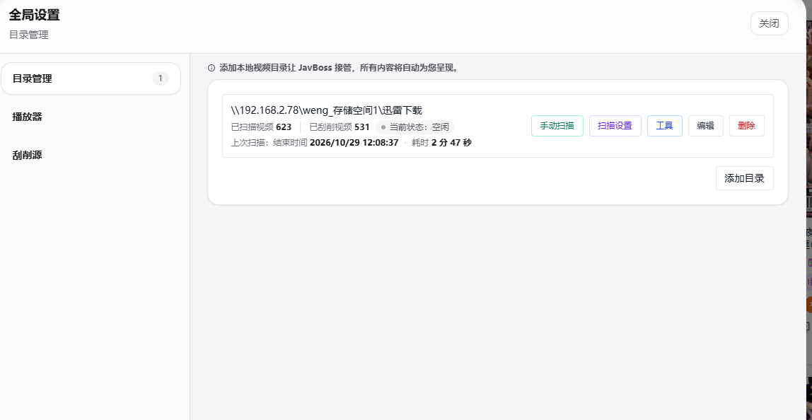

# 系统改进
## 视频刮削内容
视频要刮削的内容
1. 影视名称 （必填）
2. 番号
3. 发布日期 （必填）
4. 演员表 （必填）
5. 标签 （必填）
6. 封面图片 （必填）
7. 系列
8. 是否有码 
9. 时长 （必填）
10. 出品国家/地区

演员信息：
1. 姓名 （必填）
2. 出生日期 （必填）
3. 国籍 （必填）
4. 封面图片 （必填）
5. 身高
6. 三围
7. 罩杯

## 菜单调整
### 左侧菜单栏
左边上方菜单栏调整成
1. 视频（显示视频的海报墙）
    海报墙要显示视频必填项，另外有番号的话，就多显示一个番号
    支持手动修改所有信息
2. 演员（显示演员的海报墙）
    海报墙要显示演员信息必填项，另外显示当前收录改演员的视频数量
    支持手动修改所有信息
3. 收藏
    1. 演员(显示收藏演员的海报墙)
    2. 视频 (显示收藏视频的海报墙)

左边下方菜单调整
1. 深/浅主题
2. 设置

## 设置页面
1. 设置页面以弹窗形式弹出，不可移动
2. 设置页面分左右两栏（左边设置项， 右边具体设置内容）

### 设置项

如图
1. 目录管理
2. 播放器
3. 刮削源
> 刮削源配置尽量图形化配置，不要给一个yml格式文件，支持多个源配置

